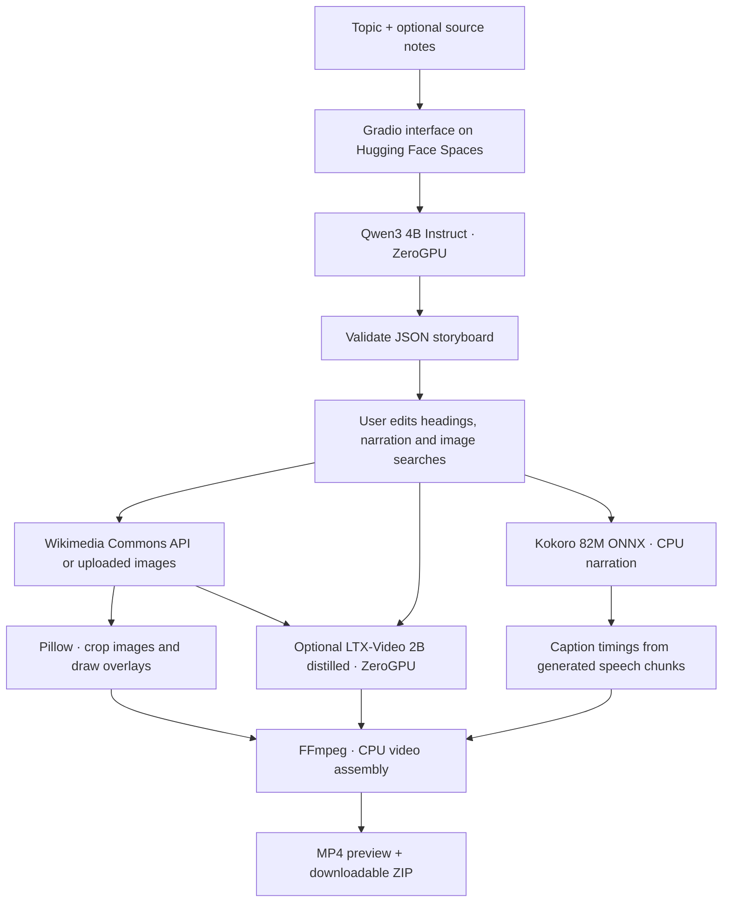

# Storycut

Turn a topic into an editable, narrated short video. Inspired by the topic-to-video workflow in [MoneyPrinterTurbo](https://github.com/harry0703/MoneyPrinterTurbo), with a new Gradio interface and a small pipeline designed for Hugging Face ZeroGPU.

Write a topic, review the AI storyboard, then export a portrait or landscape MP4 with photography, gentle motion, speech, and captions. The download bundle includes the storyboard, SRT subtitles, and image credits. The example storyboard is explicitly labelled as prewritten.

Enable **Animate images with AI** in the editor for generated moving footage. LTX-Video uses each source image and its scene's heading, narration and image-search subject to create a short shot. The option is off by default; photo mode remains available without a video-generation GPU call.

## How it works



Storyboard generation and optional AI motion lease a GPU. AI motion requests one bounded lease per scene; downloads, speech and encoding stay outside those leases. No Cloudflare account, paid inference API, or stock-media key is needed at runtime. Hosting still requires an eligible Hugging Face account; visitor GPU quotas and queues apply to both text and video generation.

## Run locally

Use Python 3.12 or 3.13 (Kokoro ONNX currently requires Python below 3.14). The Space uses Python 3.12.12 and a PyTorch version supported by ZeroGPU:

```sh
python3.13 -m venv .venv
.venv/bin/python -m pip install -r requirements.txt
.venv/bin/python app.py
```

Open **http://127.0.0.1:7865**. The first generation downloads roughly 8 GB of text-model weights; narration downloads a roughly 330 MB ONNX model and a voice bank. Weights are cached outside the repository. Apple Silicon uses MPS; ordinary CPU inference is possible but slower. Local inference does not consume a Hugging Face hosted-inference quota.

The first AI-motion run also downloads roughly 6 GB of video weights and 19 GB of T5 text-encoder weights. Hosted ZeroGPU preloads the models at startup as required by its CUDA allocation system; local development loads the video model on demand. LTX uses the revision-pinned `ltxv-2b-0.9.8-distilled.safetensors` checkpoint, eight distilled timesteps, and Diffusers' `LTXConditionPipeline`. The 0.9.5 repository supplies the compatible 2B configs and T5/tokenizer; the transformer and VAE weights both come from the 0.9.8 checkpoint.

## Deploy to Hugging Face

```sh
.venv/bin/python scripts/deploy.py --check
.venv/bin/hf auth login
.venv/bin/python scripts/deploy.py
```

Authenticate locally with a token that can create and write your Space; never commit or paste it into this app. The deployment script creates `<your-account>/storycut` as a public **ZeroGPU** Space and uploads only application files. It refuses to overwrite an unrelated existing Space or switch to paid hardware. `zero-a10g` is Hugging Face's API identifier for ZeroGPU, not a request to rent a dedicated A10G.

Free ZeroGPU hosting requires an eligible personal account with verified email and an account older than 30 days. Check the [current ZeroGPU requirements](https://huggingface.co/docs/hub/spaces-zerogpu). The first build/start downloads model weights. Deployment is verified only when the Space reaches `RUNNING` and completes a generation; local timings do not establish hosted performance.

## Scope and limits

- English narration, 2–6 editable scenes, at most 180 spoken words, 720p portrait or landscape at 24 fps. Length choices guide the script; the final duration follows actual speech.
- Photo mode adds gentle zoom. Optional AI motion generates 97 frames at 24 fps per scene (about four seconds), at 512×288 or 288×512, then adjusts playback to the narration and upscales to the 720p export. This is not native 720p generation. It can change image details and is labelled as AI-generated in the video. It does not include music, stock-video search, or video uploads.
- Automatic visuals come from Wikimedia Commons. Search tries a broader subject when necessary and selects public-domain, CC0, or CC BY images. Results are illustrative and need visual review. Upload one JPEG/PNG/WebP per scene to control the images.
- Source notes are optional pasted text; URLs are not fetched. The script is a draft, not a fact-checked report.
- Captions align to short generated speech chunks, not individual words. Re-rendering edited scenes does not call the LLM again.
- Temporary exports are removed after 24 hours when another render begins. The Gradio file cache also expires. Save your downloads; Spaces storage is ephemeral.
- Rendering is queued one job at a time. Storyboard writing has a separate queue. AI motion releases the GPU after each scene's inference; photo mode never requests one. If AI motion fails or quota runs out, the app reports the failure rather than silently substituting photos. Turn the option off to render without video-model inference.
- AI-motion bundles also contain `motion.json` with checkpoint revision, prompts, seeds and clip settings. Generated visuals are interpretations of the source photographs; keep their credits. They are not documentary footage.

## Development

```sh
.venv/bin/python -m pip install -r requirements-dev.txt
.venv/bin/python -m pytest -q
```

Tests cover malformed model responses, bounded input, image validation, licensing filters, caption timestamps, failed-job cleanup, and actual FFmpeg exports in both orientations and visual modes. Offline AI-motion tests use synthetic moving frames; an actual hosted model generation is a separate smoke test.

`STORYCUT_MODEL` and `STORYCUT_MODEL_REVISION` can select another compatible Transformers model. Default text/speech models are revision-pinned; dependencies are version-pinned. `STORYCUT_DEVICE` overrides local device selection. `PORT` changes the local listening port.

## Credits

Application code: MIT. [Qwen3](https://huggingface.co/Qwen/Qwen3-4B-Instruct-2507) and [Kokoro](https://huggingface.co/hexgrad/Kokoro-82M) weights: Apache 2.0. [Kokoro ONNX](https://github.com/thewh1teagle/kokoro-onnx): MIT. Figtree font: SIL Open Font License, included in `assets/FONT-LICENSE.txt`. Commons photographs retain their individual licenses; keep the generated `credits.txt` with your video when sharing.

Optional LTX-Video weights are subject to the [LTXV Open Weights License](https://huggingface.co/Lightricks/LTX-Video/blob/main/LTX-Video-Open-Weights-License-0.X.txt), including its use restrictions. Enabling AI motion is subject to those terms; the application's MIT license does not replace the model license. AI-generated visuals carry an on-screen label and a note in the credits.
